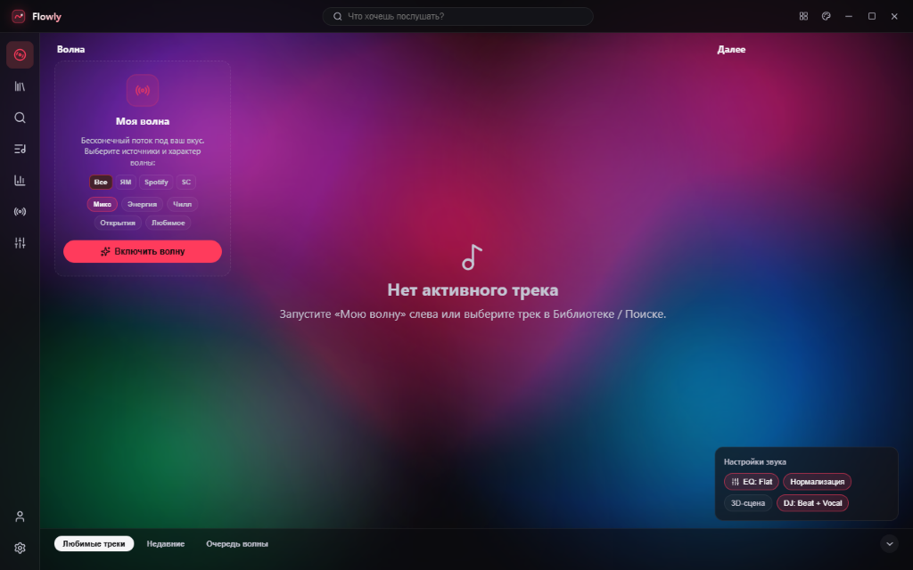
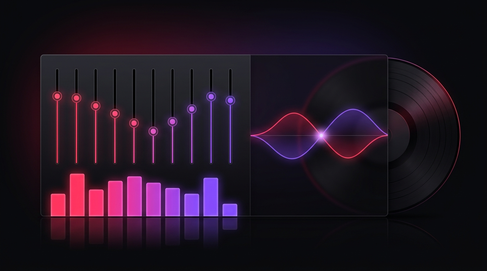
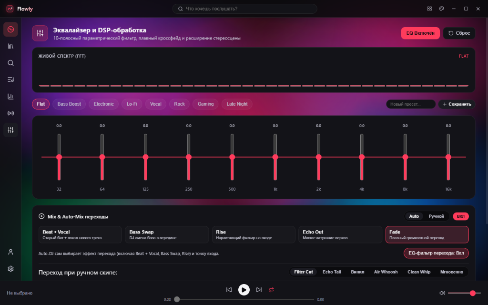
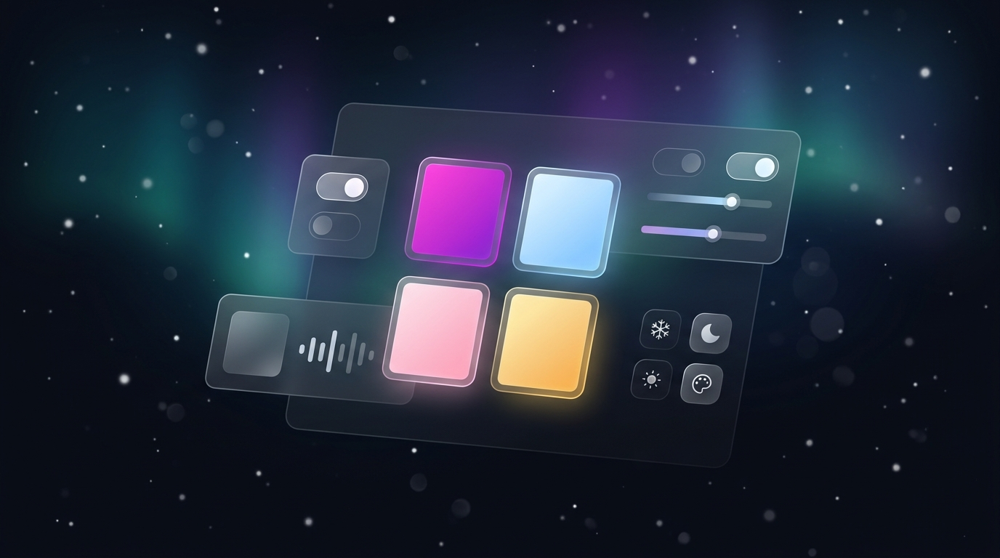
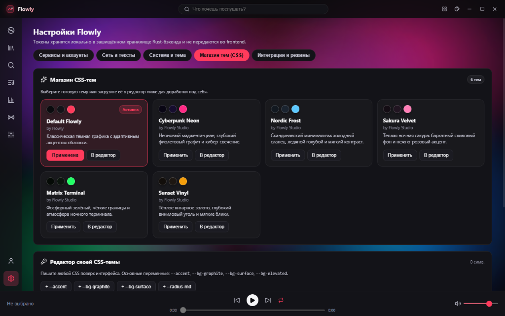

<p align="center">
  
</p>

<h1 align="center">Flowly</h1>

<p align="center">
  <b>Мультистриминговый музыкальный плеер нового поколения.</b><br>
  Яндекс Музыка, Spotify, SoundCloud и локальные файлы в одном окне.<br>
  Умный шафл, Auto-Mix с битматчингом, живая погода, CSS-темы и OTA-обновления.
</p>

<p align="center">
  <b>Скачать бесплатно</b><br><br>
  <a href="https://github.com/whoisquickyyy/flowly/releases/latest">
    
  </a>
</p>

<p align="center">
  <a href="https://github.com/whoisquickyyy/flowly/releases/latest">
    
  </a>
  <a href="https://github.com/whoisquickyyy/flowly/releases">
    
  </a>
  <a href="https://github.com/whoisquickyyy/flowly/stargazers">
    
  </a>
  
  
</p>

---

<p align="center">
  
</p>

---

## Посмотри вживую

### Главная сцена и Моя Волна


### 10-полосный эквалайзер, Auto-Mix и DJ-переходы

<br><br>


### Живая погода, магазин CSS-тем и редактор

<br><br>


---

## Возможности

### Музыка без границ и ограничений
- **4 источника в одном плеере**: Яндекс Музыка (полная коллекция без лимита в 400 треков), Spotify, SoundCloud и **локальные папки** (`MP3`, `FLAC`, `WAV`, `OGG`, `M4A`, `AAC`, `OPUS` с чтением тегов и обложек).
- **Split-Tunneling прокси + DoH**: гибкая настройка SOCKS5/HTTP прокси отдельно под каждый сервис и встроенный DNS-over-HTTPS.
- **Объединённый поиск и Моя Волна**: поиск по всем сервисам сразу, лайки, локальные подборки и «Моя волна» с выбором настроения.

### Звук и DJ-переходы
- **Два режима шафла**: честный **Обычный шафл** (Fisher-Yates с anti-repeat) и **BPM Flow** (заранее просчитанная волна по темпу с разносом артистов).
- **Auto-Mix & Beatmatching**: автоматический подбор переходов (`Beat + Vocal`, `Bass Swap`, `Rise`, `Echo Out`, `Fade`) и подгонка темпа (`playbackRate` с сохранением тональности).
- **Эффекты при ручном скипе**: `Filter Cut`, `Echo Tail`, `Винил (Brake)`, `Air Whoosh`, `Clean Whip` — без задержек и басовой каши.
- **10-полосный эквалайзер**: встроенные и кастомные пресеты (включая `Gaming`, `Lo-Fi`, `Bass Boost`), нормализация громкости, Bass Boost и 3D-сцена.

### Атмосфера и режимы
- **Четыре режима сцены**: `Wave Dock`, `Modern Analog`, `TV Mode` (кино-лаунж с часами, погодой и полноэкранным режимом) и компактные виды.
- **Динамическая тема по времени и погоде**: акцент и эффекты (дождь, снег, гроза, облака, звёзды) подстраиваются под погоду и время суток в твоём городе.
- **Магазин тем и живой CSS-редактор**: готовые темы (`Cyberpunk Neon`, `Nordic Frost`, `Sakura Velvet`, `Matrix Terminal`, `Sunset Vinyl`) + редактор собственного CSS прямо в настройках.
- **Режим экономии ОЗУ**: отключает предзагрузку второго трека, чистит буфер неактивной деки и убирает фоновые анимации.

### Интеграции
- **Синхронизированные тексты**: встроенная поддержка **Spicy Lyrics** (караоке по словам), LRCLIB и текстов Яндекс Музыки.
- **Детектор активности**: автоматически включает плейлист/эквалайзер для кодинга (VS Code / IntelliJ), игровой пресет (Steam/игры) или ставит паузу при просмотре YouTube.
- **Discord Rich Presence**: отображает текущий трек, исполнителя, обложку и таймер прямо в профиле Discord.
- **Симуляция радио**: виртуальный ведущий (`Edge Neural` / локальный `Piper TTS` / системный голос), который объявляет треки и погоду в эфире.
- **OTA-обновления**: автоматическая проверка, загрузка и установка новых версий с GitHub Releases в один клик.

---

## Сборка из исходников

<details>
<summary><b>Инструкция для разработчиков</b></summary>

### Требования
- **Node.js** 20+
- **Rust** stable (`rustup`)
- Для Windows: WebView2 и MSVC Build Tools

### Запуск в dev-режиме
```bash
git clone https://github.com/whoisquickyyy/flowly.git
cd flowly
npm install
npm run tauri dev
```

### Production-сборка
```bash
npm run tauri build
```

### Проверки
```bash
npm run check          # svelte-check (типы TypeScript / Svelte)
cd src-tauri && cargo check
```

</details>

---

## Стек

| Компонент | Технология |
|-----------|------------|
| Оболочка | Tauri 2 (Rust) |
| Фронтенд | Svelte 5, Vite 8, TypeScript |
| Аудио | Web Audio API (EQ, фильтры, битматчинг) + локальный HTTP Range-прокси |
| Локальные теги | `lofty`, `rfd` |
| Детектор окон | `active-win-pos-rs` |
| Интеграции | Spicy Lyrics, LRCLIB, Discord RPC, Edge/Piper TTS |
| CI/CD и OTA | GitHub Actions (`tauri-action`), `tauri-plugin-updater` |

---

<p align="center">
  <a href="https://github.com/whoisquickyyy/flowly/releases/latest">
    
  </a>
</p>
